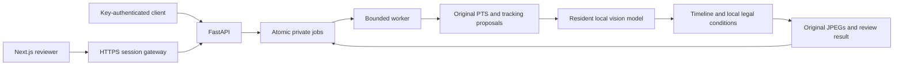

# Forte Review · ForteBank Datathon 2026

Source-bound video review for cash operations. Forte Review turns an authorized MOV into a chronological review of possible issues, original timestamped JPEG evidence and explicit legal-condition findings. It preserves uncertainty and human corrections so a reviewer can check what supports each result.

[**Try the live UI demo**](https://fortebank-review-demo.vercel.app) · [**Jury documentation**](docs-site/introduction.mdx) · [**v1 API contract**](contracts/api-contract.json) · [**v2 review API**](contracts/reasoning-api-contract.json)

> **Current boundary:** the Vercel site is a generated-data interface demo. Click **Load sample review**; no account is required. It does not analyze your own video or connect to the GPU evaluation. Real inference requires a prepared, authorized local CUDA service. Recognition and legal accuracy have not passed acceptance.

## What it does

- Validates and admits MOV uploads asynchronously, with explicit capacity, timeout and failure states.
- Runs frozen local vision inference, anonymous participant proposals and chronological observation scheduling.
- Binds every returned frame to the unchanged source hash and original presentation timestamp.
- Retrieves exact local public-law provisions and preserves unknown applicability, draft interpretations and skipped work.
- Offers original playback, event seeking, evidence, investigation filters, condition findings and immutable scoped corrections.
- Retains the exact binary jury v1 contract alongside the richer v2 review API.

The aim is to reduce the work of finding and checking visible evidence. A proposal is not a determination of liability. The service does not infer identities, hidden accounting facts or intent.

## Architecture



Python 3.12, FastAPI/Uvicorn, Pydantic, PyAV/FFmpeg, vLLM, YOLOX/ByteTrack and frozen OSNet form the local backend. The interface uses Next.js 16.4, TypeScript, React, Tailwind, the approved shadcn preset and Lucide. One API process owns a filesystem job root; no Redis or separate queue service is required.

The selected `frozen27b` profile pins Qwen/Qwen3.8-27B revision `1d4bf0f2ff6012fd82039f2fa52739d0dd7c60c0`, BF16, 16,384 context tokens and no adapters. The explicit `baseline8b` profile retains Qwen3-VL-8B-Instruct revision `0c351dd01ed87e9c1b53cbc748cba10e6187ff3b`. One model is resident; a same-model v1/v2 pipeline comparison is not an 8B/27B benchmark.

## Quick start

The repository is currently private; authorized GitHub access is required. The documentation is validated against application source `ae9f819c3d7063e8bcf0e51855e5b4773c1961df`.

```bash
git clone https://github.com/itsaibarr/fortebank-datathon-26.git
cd fortebank-datathon-26
uv sync --frozen
uv run forte --help
uv run pytest -q
uv run python scripts/verify_documentation.py
```

Use Python 3.12. This installs the source foundation and runs generated-data checks; it does not download models, install CUDA or make inference ready. For a first visible result without hardware, use the [public UI demo](https://fortebank-review-demo.vercel.app).

To build the frontend with Node.js/npm:

```bash
npm --prefix web ci
npm --prefix web test
npm --prefix web run typecheck
npm --prefix web run lint
npm --prefix web run build
```

The export is `web/out`. A standalone frontend server does not supply sessions or the inference API. Follow [installation](docs-site/guides/installation.mdx), [environment configuration](docs-site/guides/configuration.mdx) and [startup/readiness](docs-site/guides/operations.mdx) for the real service. Compatible Linux x86_64/NVIDIA CUDA hardware and hash-verified public model/tracking/legal assets are separate prerequisites.

## API usage

[Generate or configure a private service key](docs-site/api/authentication.mdx). Set `BASE_URL` to your own ready inference origin, `SAMPLE_FILE` to an authorized MOV and `FORTE_EXAMPLE_ROOT` to private client storage. The demo URL is not that origin.

```bash
curl --fail-with-body --silent --show-error \
  --header @"$FORTE_EXAMPLE_ROOT/request.headers" \
  --form "file=@$SAMPLE_FILE;type=video/quicktime" \
  --output "$FORTE_EXAMPLE_ROOT/accepted.json" \
  "$BASE_URL/api/v1/analyze"
```

POST returns **202 with `job_id`**. Poll `GET /api/v1/jobs/{job_id}` with the same `X-API-Key` until `processing` becomes `done` or `failed`. A successful v1 result uses only `violation` or `no_violation`; supported events contain one to three original JPEGs and source timestamps. See the [complete v1 workflow](docs-site/api/v1.mdx).

[V2](docs-site/api/v2.mdx) adds original source/evidence resources, participants, legal conditions, coverage, corrections and reports. `done` with `insufficient_evidence` is a successful abstention, not a clean negative. V1 defaults to the legacy detector; explicit `FORTE_V1_PIPELINE=reasoning` requires the reasoning configuration and conservatively projects into the unchanged jury schema.

Actual limits: MOV, 256 MiB complete multipart body, 180 seconds, 30-second upload deadline, 270-second job budget and two admitted jobs. Readiness must be 200 before upload. See [errors](docs-site/api/errors.mdx).

## Verified results and reproducibility

| Evidence | Verified observation | Interpretation |
| --- | --- | --- |
| Source checks at `ae9f819` | 505 Python tests pass; one optional Docker skip, four existing warnings | Software mechanics, not model accuracy. |
| Frontend | 17 tests; lint, TypeScript and static export pass | Generated-data UI mechanics. |
| Historical real GPU run, earlier `111234c` image | Two partial/insufficient API completions in 257.43 s and 258.04 s; third admission 429 | Loopback measurements, not current UI p95, complete coverage or quality acceptance. |
| Returned source/PTS/JPEGs in that run | Integrity checks passed | Correct origin does not establish semantic relevance. |
| Recognition/legal accuracy | No accepted score | Earlier exploratory runs failed semantic acceptance; independent references and applicability remain incomplete. |

The historical final production delta was not fully preserved. Do not claim complete result replay from that archive. The current evaluation remains separate until its results and identities are verified.

Reproduce the [software and private evaluation procedures](docs-site/evaluation/reproduce.mdx). `forte evaluate` accepts completed **v1** development client directories, checks source hashes and reports counts, failure-aware accuracy/effective recall, point proximity and latency. V2 abstentions need their own explicit protocol. No jury/reserved media enter training or model selection; no weight training or adaptation is authorized.

## Documentation and project layout

The Mintlify source is [`docs-site/`](docs-site/docs.json). It covers the complete jury journey, configuration, authentication, API examples, review, evaluation, troubleshooting and limitations. [Maintain and validate it](docs-site/guides/documentation.mdx). A hosted Mintlify URL is added only after actual publishing succeeds.

| Path | Contents |
| --- | --- |
| `src/forte/`, `tests/` | Application and generated-data verification. |
| `web/` | Production review interface source. |
| `contracts/`, `configs/`, `legal/` | Exact interfaces, pinned configuration and scoped public sources. |
| `scripts/`, `tools/`, `deploy/` | Checks, private rehearsal, sessions and deployment components. |
| `docs-site/` | Jury-facing Mintlify documentation. |
| [`docs/`](docs/README.md), `.context/verify/` | Engineering history, decisions and preserved evidence. |

Private originals, annotations, frames, outputs, service keys and backups remain outside Git. Real browser sessions keep service secrets server-side and enforce case ownership. Retention is manual. Read [technical limitations](docs-site/evaluation/limitations.mdx) before comparing or deploying the system.
