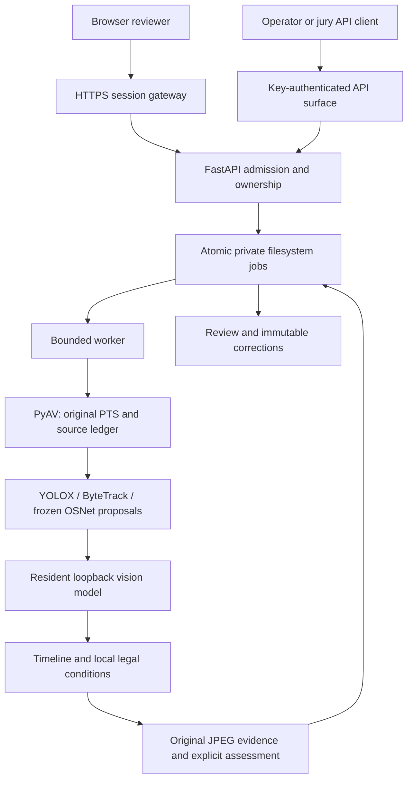

The canonical application uses Python 3.12, FastAPI/Uvicorn, Pydantic, PyAV and a resident vLLM model. The interface is a Next.js 16.4 static export with TypeScript, React, Tailwind, the approved shadcn preset and Lucide. No Redis, Celery or external AI inference endpoint is part of this architecture.

## Evidence before conclusions

The decoder preserves original presentation timestamps and time bases. Model responses refer to supplied frame/participant identifiers; application code derives timestamps and checks evidence bindings. A detector box, tracker association, participant identity, role hypothesis and human correction are independent origins. A mirror view does not create another physical person.

## Two contracts, explicit dispatch

V1 preserves the required binary result schema. Default `FORTE_V1_PIPELINE=legacy` retains the original path. Explicit `reasoning`, with a reasoning configuration, projects only source-verified supported outcomes into that same schema. Insufficient evidence becomes a terminal v1 failure. V2 exposes execution and assessment independently; its jobs are not readable through v1.

## Model profiles

| Profile | Pinned model | Context | Precision |
| --- | --- | --- | --- |
| `baseline8b` | Qwen/Qwen3-VL-8B-Instruct, revision `0c351dd01ed87e9c1b53cbc748cba10e6187ff3b` | 8,192 | BF16 |
| `frozen27b` | Qwen/Qwen3.8-27B, revision `1d4bf0f2ff6012fd82039f2fa52739d0dd7c60c0` | 16,384 | BF16 |

One selected model is resident. A legacy-pipeline run on the 27B model is not an 8B/27B comparison. No adapter, quantization or weight adaptation is selected.

## Trade-offs

Atomic files keep the deployment small but require a single API process per job root. Strict source/ownership checks reject ambiguous history. Bounded sampling and one model sequence constrain throughput and coverage. Local legal retrieval preserves exact clauses but cannot establish unknown historical applicability or approve draft interpretations.

The [Vercel demo](/guides/review) is a separate static build with generated assets and a browser-only simulator. It does not host this inference runtime.
