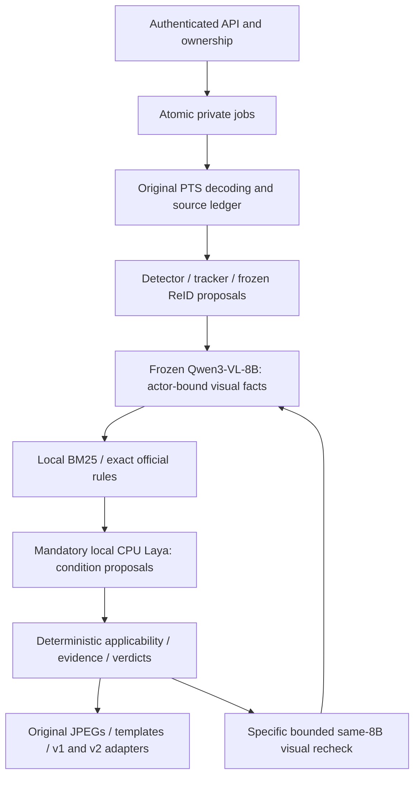

The sole architecture reference is repository `report.md`. Both API versions adapt one implementation in `src/forte/pipeline.py`; `worker.py` always invokes it.

## Selected models

| Component | Pinned identity | Boundary |
| --- | --- | --- |
| Vision | `Qwen/Qwen3-VL-8B-Instruct`, revision `0c351dd01ed87e9c1b53cbc748cba10e6187ff3b` | Frozen BF16, vLLM, 8,192 total tokens; visual facts rather than legal verdicts. |
| Conditions | `convaiinnovations/laya-multilingual`, revision `1720e3e3357cfe1e281542e223f8273b0890ca34` | Resident local CPU FP32; text-only `satisfied`, `contradicted`, `unknown` choices. |

Laya's runtime is pinned to upstream commit `d74e8be46ef5241e4ba2b16cd25e896f24f71373`. Its tokenizer counts instructions, options and fact state against the shipped 1,024-token limit. Required counterevidence is preserved; packets that cannot fit are refused instead of truncated. Independent questions use batches of at most four rows. Missing or unhealthy Laya fails readiness. Actual checkpoint/runtime compatibility remains unverified.

## Evidence before conclusions

Chronological overlapping 16-second windows start every 12 seconds, using up to sixteen images at approximately 1 FPS. Code merges facts and role history. A specific unresolved visual dependency permits a deduplicated recheck with the same 8B model, within the job-wide bound and absolute deadline. Skipped windows and output overflow remain incomplete work.

The decoder preserves original PTS, time bases, orientation, frame identity and reversible crops. Actor/recipient references, counterevidence, unknown identity and reflection ownership remain explicit. Detector boxes, tracker associations, ReID proposals, model observations and human corrections have independent origins and review scopes.

Local lexical/exact retrieval provides official clauses and rule cards. Code evaluates polarity, applicability, prerequisites, exceptions, metadata and source evidence. Draft cards remain draft. An omission needs a complete visible opportunity; sparse sampling cannot establish absence. Code constructs explanations and citations from templates and exports one to three original JPEGs per reported event.

## Two adapters, one pipeline

V1 keeps the exact jury binary contract. Insufficient evidence becomes terminal failure, never a successful negative. V2 exposes execution, assessment and human-review state separately. A supported event may survive unrelated incomplete work; a clean negative needs adequate scope and coverage.

## Runtime and access

The application uses Python 3.12, FastAPI, PyAV, one application container, local vLLM and resident CPU Laya. Atomic filesystem jobs require one API process per job root. One visual queue bounds GPU calls. The approved UI remains Next.js/TypeScript, Tailwind, shadcn and Lucide. Its HTTPS gateway preserves principal ownership, protected cookies and CSRF.

The [public generated-data demo](/guides/review) does not host this runtime. This Mintlify documentation deployment does not deploy the application. Real-model quality, memory, latency and deployment acceptance remain open.
